# Island

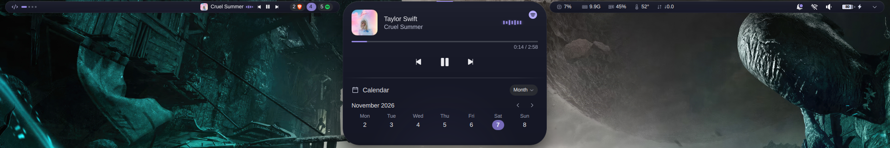

A Dynamic Island for the [Omarchy](https://omarchy.org) bar: a compact strip of pills that folds
open into cards, panels and a small notification stack. Written in QML for Quickshell, driven by
Omarchy's own scripts and state — no daemon of its own, no keybindings of its own beyond the
Omarchy ones it replaces.

> This repository is a personal, standalone copy of
> [CaioNazario/island-omarchy](https://github.com/CaioNazario/island-omarchy), rebranded to the
> plugin id `alfath.island`. It is not affiliated with upstream and does not send pull requests
> there. See [Credits](#credits).

## What you get

- **Bar pills** — workspaces and widgets on the left, the clock in the middle (Omarchy's own
  `omarchy.clock` widget), and notification bell · Wi-Fi · volume · battery · arrow on the right.
- **Environments** — four shipped sets of widgets (Default, Work, Studies, Weekend), up to six,
  switched from the bar or by scrolling over it.
- **Open island** — the pills unfold into a 660px card: quick controls, Wi-Fi, Bluetooth, mixer,
  display, notification stack and a power row.
- **Panels kept from Omarchy** — clicking the bell opens notification history, clicking Wi-Fi opens
  the network panel (QR share, DNS, speed test), volume opens the mixer, battery opens the power
  profile page, and the gear still opens Omarchy's setup menu.
- **Widgets** — AI usage, hardware, next calendar event, Pomodoro, music, weather, workspaces with
  real app icons, GitHub review queue, day progress, date countdown and a note.
- **Appearance editor** — theme, accent, fill, palette, opacity, shadow, size, style, corners,
  border and effects, all live and all stored in one JSON file.

## Screenshots

| | |
| --- | --- |
| Closed bar | 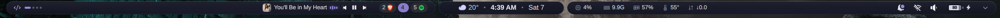 |
| Open island | 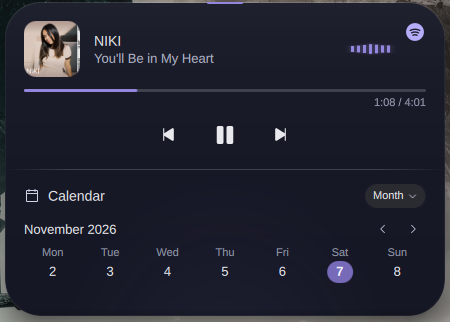 |
| Quick controls | 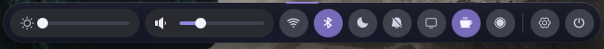 |
| Wi-Fi panel | 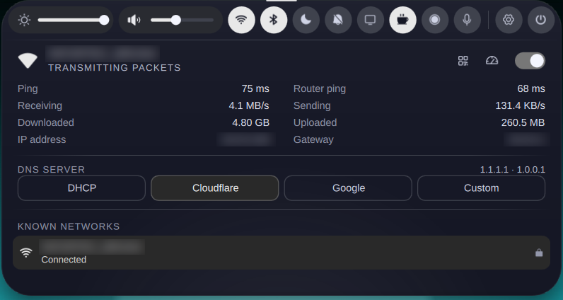 |
| Mixer | 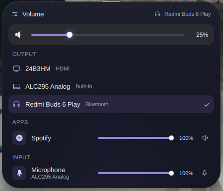 |
| AI usage | 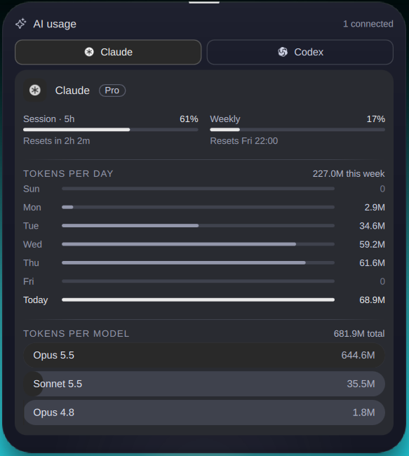 |
| Appearance page | 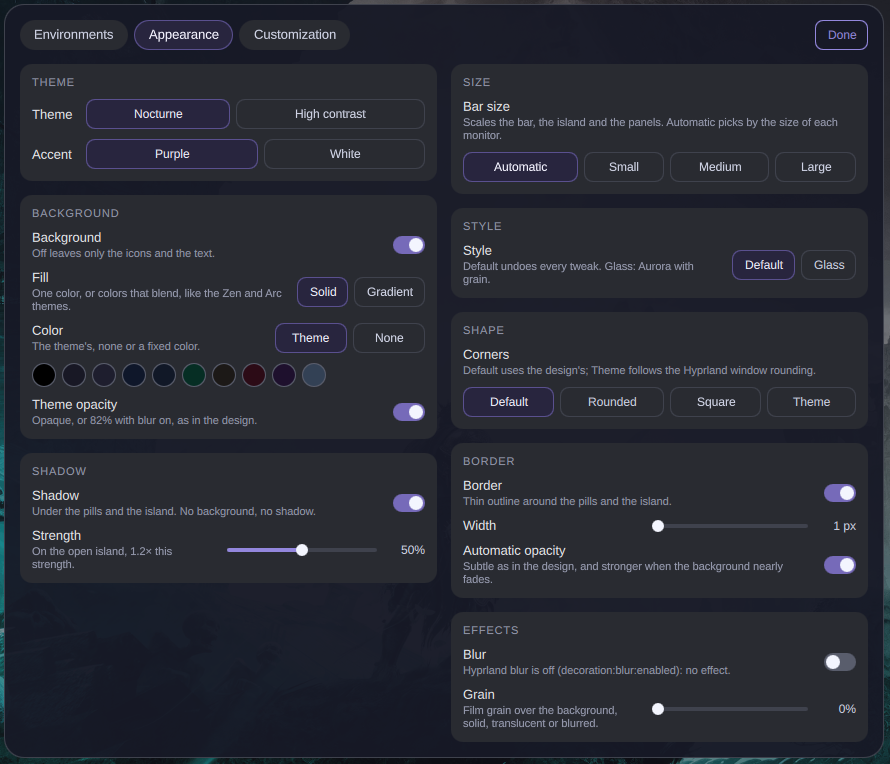 |
| Environments editor | 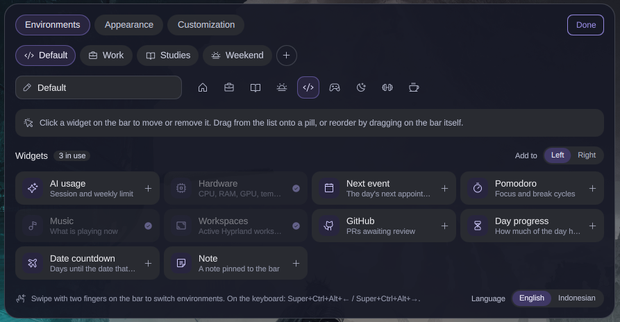 |
| Widget Customization | 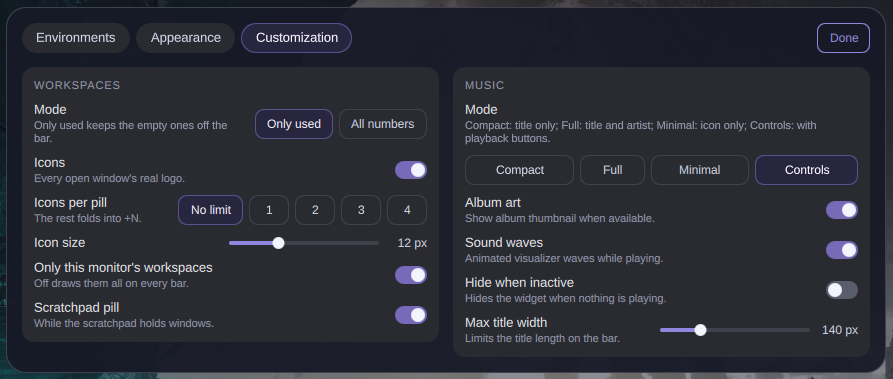 |
| Battery | 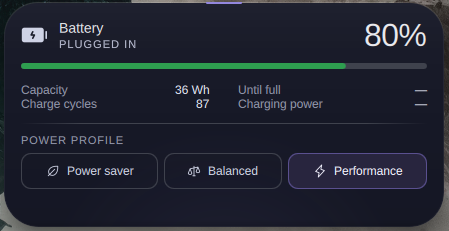 |

More in [`docs/screenshots/`](docs/screenshots)

## Requirements

Island is a bar plugin, so it needs an Omarchy install that already runs the Quickshell shell:

- Omarchy 4 (`/usr/share/omarchy/version` reports `4.0.0.alpha` on the machine this copy is
  maintained on)
- Quickshell 0.3.2 (the version Omarchy distributes)
- Hyprland 0.56

Everything else it touches is already on an Omarchy system: `wpctl`, `brightnessctl`, `nmcli`,
`bluetoothctl`, `curl`, `secret-tool`, `gh`, and the `omarchy-*` helper scripts.

## Install with Omarchy

```bash
omarchy plugin add https://github.com/RifqiNabil-dev/DynamicIsland-Omarchy.git --enable
```

`omarchy plugin add` clones the repo into `~/.config/omarchy/plugins/alfath.island`, reads
`manifest.json` and registers the plugin id from it. `--enable` turns it on; without it, run:

```bash
omarchy plugin enable alfath.island
```

Two things happen on first load:

1. `~/.config/omarchy/shell.json` gets `bar.id = "alfath.island"`, and the built-in
   `omarchy.notifications` and `omarchy.osd` plugins are added to `disabledPlugins` so the
   notification UI and the OSD are not drawn twice — Island answers `omarchy-shell osd show`
   through its own `osd` IPC target instead.
2. Settings appear in `~/.config/island/settings.json` (directory `0700`, because it can hold the
   note text and environment names).

The bar keeps Omarchy's `shell.json` layout: the clock, indicators, tray and per-monitor widgets
stay where they are; Island only replaces the bar itself. If `~/.config/hypr/hyprland.lua` loads
`~/.config/omarchy/plugins/alfath.island/hypr/island.lua`, remove that line — Island is a plugin
now, and that file only predates the plugin loader.

### Update

```bash
omarchy plugin update alfath.island
omarchy-restart-shell
```

### Uninstall

```bash
omarchy plugin remove alfath.island --yes
```

That removes the clone and the `bar.id` entry. `~/.config/island/settings.json` is left alone; delete
it by hand if you want the defaults back.

### From source

```bash
git clone https://github.com/RifqiNabil-dev/DynamicIsland-Omarchy.git
ln -s "$PWD/DynamicIsland-Omarchy" ~/.config/omarchy/plugins/alfath.island
omarchy plugin enable alfath.island
```

## Using it

| Action | How |
| --- | --- |
| Open the quick panel | `Super+S`, or click any pill that is not a button |
| Close whatever is open | `Super+S` again, `Esc`, or a click outside the island |
| Switch environment | Scroll left/right over the bar, click the environment dots, or the `island` IPC calls below |
| Notification history | Click the bell |
| Wi-Fi panel | Click the Wi-Fi icon |
| Bluetooth panel | Click the Bluetooth tile in the quick panel |
| Mixer | Click the volume icon (scroll over it changes volume by 5%) |
| Display | The monitor tile in the quick panel |
| Power row | The power button, far right of the quick panel |
| Settings menu | The gear in the quick panel |
| Do Not Disturb | Omarchy's own shortcut (`Super+,`) and scripts |

`clickAction` decides what a click on the center card does: `card` opens the island, `calendar`
opens the month view.

### IPC

Island answers to `omarchy-shell` on three targets — the first two are the ones Omarchy's scripts
already call, so volume/brightness OSDs and the notification helpers keep working untouched:

```bash
omarchy-shell notifications showHistory    # also: dndState, toggleDnd, setDnd, isDnd,
                                           #       clear, dismissAll, dismissOne,
                                           #       invokeLast, dismiss, ping
omarchy-shell osd show '<json>'            # also: close, state, ping
omarchy-shell island toggleQuick           # also: openStack, closeStack,
                                           #       nextEnvironment, previousEnvironment, ping
```

## Environments and widgets

Four environments ship by default; the editor adds up to six. Widgets sit in two slots, left and
right, and the clock is not a widget — it is Omarchy's own.

| Environment | Icon | Left | Right |
| --- | --- | --- | --- |
| Default | house | Workspaces, AI usage | Hardware |
| Work | briefcase | Next event, Pomodoro, AI usage | Hardware, GitHub |
| Studies | book-open | Day progress, Pomodoro | Note |
| Weekend | sun-horizon | Music | Date countdown |

The first environment cannot be removed and the list always keeps at least one. Unknown widget ids,
duplicates inside one environment, unknown icons and over-long names are dropped on load, so a
hand-edited `settings.json` cannot break the bar.

Widgets exported by other Omarchy plugins can be placed too: in the editor they appear as
`plugin:<pluginId>`, and they stay in the environment even while that plugin is not loaded — the
slot just draws nothing until it is.

### Widget behavior

| Widget | What it shows | Where it reads from |
| --- | --- | --- |
| AI usage | Session and weekly limit per provider | `~/.local/state/omarchy/agents/usage/*.json`, refreshed by `omarchy-agent-usage-update`; Claude and Codex can be turned off with `aiClaudeEnabled` / `aiCodexEnabled` |
| Hardware | CPU, RAM, GPU, temperature, network | `/proc/stat`, `/proc/meminfo`, `/proc/net/dev`, plus the GPU and temperature paths Omarchy's `detect-hardware.sh` reports (amdgpu, i915, xe) |
| Next event | The day's next appointment, plus a month view | An iCalendar URL kept in the keyring: `secret-tool lookup service island kind calendar-ics` |
| Pomodoro | Focus 25:00 → break 5:00, with notifications at each switch | Its own timer state in `~/.local/state/island` |
| Music | Title, artist, album art, progress, optional controls | Quickshell's MPRIS interface — no `playerctl` involved |
| Workspaces | Active Hyprland workspaces, real app icons, scratchpad pill | Hyprland IPC |
| GitHub | PRs with `review-requested:@me` | `gh auth token` + the GitHub search API |
| Day progress | How much of the day has passed | Local clock |
| Date countdown | Days until `countdownDate` | `countdownName` / `countdownDate` |
| Note | A pinned line of text, editable in place | `noteText` |

The weather next to the clock is Omarchy's own widget; Island's compact card shows the same city.
Without a city in `weatherLocation` it falls back to `~/.local/state/omarchy/settings/weather.json`
from `omarchy-weather-location`, and with no coordinates at all it detects the area by IP.

### Workspaces settings

| Key | Default | Meaning |
| --- | --- | --- |
| `wsPerMonitor` | `false` | `false` shows Hyprland's global ids on every bar, like Omarchy's own workspaces widget |
| `wsShowEmpty` | `false` | Also draw empty workspaces — the Appearance page exposes this as Mode: Only used / All numbers |
| `wsShowIcons` | `true` | Real window logos, folded into `+N` past the limit |
| `wsMaxIcons` | `0` | Icons per pill, `0`–`8`, `0` = no limit |
| `wsIconSize` | `12` | `6`–`24` px |
| `wsIconGap` | `4` | `0`–`12` px |
| `wsMaxId` | `10` | Highest workspace id drawn |
| `wsScratchpad` | `true` | Show the scratchpad as its own pill |
| `wsScratchpadLabel` | `"S"` | Up to four characters |

### Music settings

| Key | Default | Meaning |
| --- | --- | --- |
| `musicMode` | `"compact"` | `compact` (title), `full` (title + artist), `minimal` (icon or wave only), `controls` (adds media buttons) |
| `musicShowArt` | `true` | Album art |
| `musicShowWaves` | `true` | Animated bars while playing |
| `musicHideIdle` | `false` | Hide the pill when nothing is playing |
| `musicMaxWidth` | `140` | Width cap in px |

### Panels

| Mode | Content |
| --- | --- |
| `quick` | Brightness and volume sliders, Wi-Fi, Bluetooth, night light, Do Not Disturb, display, keep-awake, screen recording, dictation, settings, power |
| `wifi` | Current network, known networks, other networks, QR share of the current network (open networks say so), DNS server, speed test; joining a network opens `nmtui-connect` in Omarchy's floating terminal |
| `bt` | Adapter state, paired devices, scanning; pairing opens `bluetoothctl` in the floating terminal |
| `mixer` | Outputs, per-application streams, microphone, mute |
| `display` | Brightness, text size, monitor scale |
| `weather` | Current condition, the next days' highs and lows, and a city search; the chosen city goes to `weatherLocation` |
| `stack` | Notification history, with clear and dismiss |
| power row | Suspend, restart, shut down, log out, lock — Omarchy's `omarchy-system-*` scripts |

Tiles whose hardware or service is missing simply do not appear: no backlight means the volume
slider takes the brightness slot, no night light means no tile, no `voxtype` means no dictation
tile, no Wi-Fi or Bluetooth radio means no radio tile.

## Appearance

Everything on the Appearance page is live and stored under the `appearance` key; `null` means "the
design's look".

| Section | Options |
| --- | --- |
| Theme | Nocturne, High contrast |
| Accent | Purple, White |
| Background | On/off, Fill (Solid / Gradient), Color (theme, none, or a fixed color: 10 dark swatches), Palette (theme + 9 gradients), Strength, Theme opacity (opaque, or 82% with blur), Opacity |
| Shadow | On/off, Strength (1.2× on the open island) |
| Size | Automatic, Small, Medium, Large — the same values as `barSize` |
| Style | Default, Glass (the preset from omadock's `builtin_glass`) |
| Shape | Corners (Default / Rounded / Square / Theme), Radius |
| Border | On/off, Width, Automatic opacity, Border opacity |
| Effects | Blur, Grain |

The Workspaces widget's own settings (mode, icons, icons per pill, icon size, per-monitor
filtering, scratchpad) are on the **Customization** tab, not here.

## Settings

`~/.config/island/settings.json` is watched: edit it by hand or through the UI, the bar picks the
change up immediately. Atomic writes, so a crash mid-write cannot leave half a file.

| Key | Default | Notes |
| --- | --- | --- |
| `language` | `"en"` | `en` or `id` |
| `clickAction` | `"card"` | `card` or `calendar` |
| `barSize` | `"auto"` | `auto`, `small`, `medium`, `large` |
| `theme` | `"Nocturne"` | or `"Alto contraste"` in the file (shown as High contrast) |
| `accent` | `"Roxo"` | or `"Branco"` in the file (shown as White) |
| `appearance` | `null` | Appearance page object |
| `environments` | `[]` | Empty means the four shipped ones; otherwise `[name, icon, [left], [right]]` |
| `environmentIndex` | `0` | Current environment |
| `aiClaudeEnabled`, `aiCodexEnabled` | `true` | Which AI usage providers are shown |
| `weatherLocation` | `null` | `{ "name": …, "latitude": …, "longitude": … }` |
| `noteText` | `""` | The note widget |
| `countdownName`, `countdownDate` | `""` | Date as `YYYY-MM-DD` |
| `ws*` | see above | Workspaces widget |
| `music*` | see above | Music widget |
| `autoHide` | `false` | Accepted and stored, but the bar does not hide itself yet |

## Architecture

```
Bar.qml            the bar per monitor: pills, right buttons, mode switching
Service.qml        one instance per shell: settings, IPC targets, mode state
core/              the logic, testable without QML (environments, appearance,
                   workspaces, music, weather, pomodoro, ICS, i18n, sanitizers)
system/            the sources that talk to the machine: audio, brightness, wifi,
                   bluetooth, battery, idle, night light, session, calendar,
                   agents, weather, screen recording, dictation
ui/                the visual layer: pills, tiles, sliders, cards, panels,
                   the appearance page, the environments editor, plugin widgets
shaders/           the grain and blur helpers
hypr/island.lua    optional Hyprland shortcuts kept from before the plugin era
docs/screenshots/  the images in this README
```

`core/*.mjs` holds no QML imports, so the rules the bar depends on (environment sanitizing, URL and
text limits, icon folding, number ranges) are plain functions over plain data — that is also where
this copy's hardening lives: values that reach a shell command are quoted and length-checked, and
the music art URL is restricted to what MPRIS may legitimately hand over.

## Limitations

- **Auto-hide is not implemented.** The key exists and is stored, but nothing reads it; the bar
  stays where it is.
- **Environment icons come from a fixed set** (the ones in the editor), not from arbitrary icon
  names.
- **Weather needs a location.** With no `weatherLocation` and no `weather.json` there is no weather
  at all rather than a guess.
- **The GitHub widget needs `gh` logged in.** Without a token the pill stays empty.
- **Single accent pair.** Purple and White are the design's two accents; there is no arbitrary
  color picker for the accent itself.

## Development

```bash
omarchy plugin validate .          # manifest + structure
omarchy-restart-shell              # reload the bar after editing
qmllint Bar.qml Service.qml        # QML syntax; Qt 6.12 crashes on
                                   # `pragma ComponentBehavior: Bound`, so lint a
                                   # copy with that pragma removed
```

The logic in `core/*.mjs` runs without Quickshell, which is how the hardening checks are verified:

```bash
node --input-type=module -e "import('./core/environments.mjs').then(m => console.log(m.defaultEnvironments('en')))"
```

## Credits

Island is a fork of [CaioNazario/island-omarchy](https://github.com/CaioNazario/island-omarchy), by
Caio Nazario. The design, the specs and most of the code are theirs; this copy carries the plugin id
`alfath.island`, a hardening pass over the shell-command paths, and documentation rewritten against
the code in this repository. Attributed work stays attributed.

## License

GPL-3.0. See [LICENSE](LICENSE).
